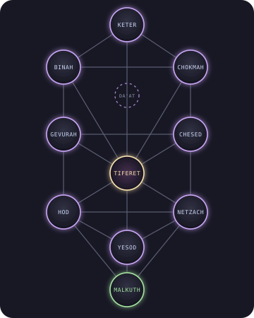

<div align="center">



# 🌳 Kabbalah · Tree of Life

**Marco Daniel S. Castillo**
<br>
*student of the roots · builder of the branches*


<br>
<a href="https://github.com/KabbalahTreeofLife?tab=followers">
  </a>


</div>

---

### 𓂀 I · The Premise

> *Roots drink in the dark long before the branches ever see light.*

I am a **second-year student** in the 🇵🇭 **Philippines**, studying Software Engineering from the ground up. My handle is not a flex. It is a doctrine:

**depth before height.** Fundamentals before frameworks. Yesod before Keter.

In Kabbalah the Tree of Life is a map of how the infinite becomes the finite, descending through ten emanations into the world we can touch. Software is the same descent: an idea, an architecture, a function, a pixel. I am trying to climb that path in the other direction, **from the kingdom back toward the crown**, one understood layer at a time.

- 🔭 **Now:** looking up, building [Centralian Skywatch](https://github.com/KabbalahTreeofLife/Centralian_Skywatch)
- 🎮 **Studying:** worlds and the rules that govern them, through Godot and object-oriented design
- 🗺️ **Drawn to:** anything with a map, a graph, or something moving on screen. Every path is a story.
- ⚡ **Confession:** I use Neovim (btw). Even my editor is a ritual of modes.

---

### 🕯️ II · The Work: Three Paths on the Tree

The Tree has ten spheres, but it is the **twenty-two paths between them** that hold the teaching. These are mine.

| Path | The question it asks | The vessel |
| :--- | :--- | :--- |
| 🛰️ **[Centralian Skywatch](https://github.com/KabbalahTreeofLife/Centralian_Skywatch)**<br>*the gaze upward* | *What is above us, and can we watch it move?* NASA's picture of the day, rocket launches, and the live position of the ISS. Favorites and notes outlast every restart. |   |
| 🔭 **[Overseer](https://github.com/KabbalahTreeofLife/Overseer)**<br>*the search for Da'at* | *How do ideas descend from one another?* A niche academic search engine across OpenAlex, Semantic Scholar, and arXiv, with a citation graph where knowledge is shown as a living web. |     |
| 🧭 **[U-Nav](https://github.com/KabbalahTreeofLife/U-Nav)**<br>*the walker of paths* | *Where am I, and how do I get there?* Campus navigation in 3D and 2D with pathfinding, a crowd heat map, events, and a dining guide. |     |

---

### 🌌 III · The Ten Spheres (My Stack)

I read my toolbox as a Tree: grounded at the bottom, reaching at the top.

| Sephirah | Meaning | In my practice |
| :--- | :--- | :--- |
| **Keter** · כתר<br>*Crown* | The unreachable source | *Still ahead. The reason I keep learning.* |
| **Chokmah** · חכמה<br>*Wisdom* | The spark of the idea |  game worlds and their rules |
| **Binah** · בינה<br>*Understanding* | The idea given form |   the fundamentals, in OOP |
| **Da'at** · דעת<br>*Knowledge* | The hidden sphere | The thing I chase in every project. Overseer is its shrine. |
| **Chesed** · חסד<br>*Mercy* | Openness, expansion |   one codebase, many hands |
| **Gevurah** · גבורה<br>*Severity* | Limits, discipline |   servers, schemas, and strict structure |
| **Tiferet** · תפארת<br>*Beauty* | Harmony of opposites |      |
| **Netzach** · נצח<br>*Endurance* | Persistence |   the daily ritual |
| **Hod** · הוד<br>*Splendor* | Language, logic |   |
| **Yesod** · יסוד<br>*Foundation* | What everything rests on |   data, the memory of every system |
| **Malkuth** · מלכות<br>*Kingdom* | The world that can be touched |  shipped, deployed, real |

---

### 📜 IV · The Descent Is Not the Point

```
   The Tree is usually drawn from the top down,
   as creation flowing into the world.

   But the practitioner walks it from the bottom up.

   Malkuth  →  Yesod  →  Hod  →  Netzach  →  Tiferet  →  ...

   Ship something real.      Learn it deeply.      Then ask what lies above it.
```

I do not think of learning as collecting tools. I think of it as **ascent**: you do not skip a sphere, and what you cannot explain, you do not yet own.

---

### 👁️ V · The Observatory (GitHub Analytics)

<div align="center">

<table>
  <tr>
    <td align="center" width="50%">
      
    </td>
    <td align="center" width="50%">
      
    </td>
  </tr>
</table>


</div>

---

<p align="center">
  <i>"Seeking knowledge from the roots to the branches."</i>
  <br><br>
  ✦ &nbsp; <b>Ein Sof</b> &nbsp; · &nbsp; <i>without end</i> &nbsp; ✦
</p>
